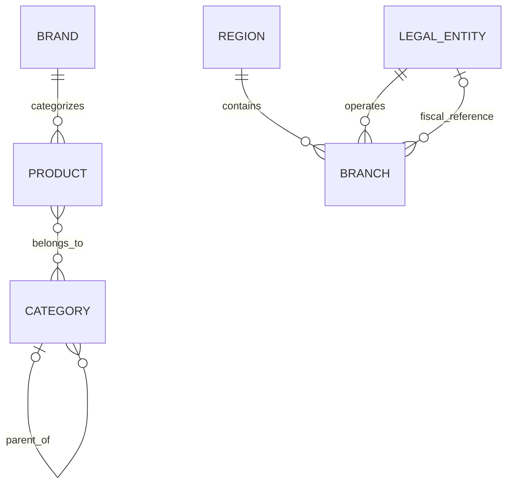

# Corporación Azul — WordPress V1 / Laravel V2 Content Blueprint

**Step 5 · Create and validate the schema design**
**Status:** Conceptual model validated offline; WordPress integration pending.
**Package version:** 0.2 (working draft; no production changes).

## Goal and business scope

Corporación Azul's first release is an **informational corporate and product showcase**, not an online store. It presents construction-material categories such as **cement and lime, steel, adhesives/coatings, and construction complements**. Products and branches can link to WhatsApp or contact channels. The company's wholesale orientation may influence **editorial descriptions**, but **does not impose online cart, quantities, delivery calculations or minimum purchase validation**.

V1: **WordPress is the content source of truth** for products, brands, categories, branches, regions and legal entities. React presents the public website; Laravel may normalize the WordPress REST responses into a stable API contract. Contact submissions are managed separately by a WordPress form solution, and basic anonymous/aggregate analytics by an analytics solution.

V2: a Laravel Admin can manage migrated data in new Laravel-owned tables. The migration requires data export, ID mapping, media transfer, referential checks and API compatibility testing; it does not happen automatically.

**Not in V1:** carts, checkout, orders, payments, customer accounts, stock per branch, order quantities, price/availability by branch, assigned sales advisors, lead statuses or a CRM.

## Entity blueprint

| Logical entity | WordPress V1 | Laravel V2 candidate | Key relationships |
|---|---|---|---|
| Product | Custom Post Type `ca_product` | `products` | One brand; multiple categories |
| Brand | Taxonomy `ca_brand` | `brands` | Many products |
| Category | Hierarchical taxonomy `ca_product_category` | `categories`, pivot `category_product` | Many products; optional parent category |
| Branch | Custom Post Type `ca_branch` | `branches` | One operational region and operating entity; optional fiscal entity |
| Region | Taxonomy `ca_region` | `regions` | Many branches |
| Legal entity | Custom Post Type `ca_legal_entity` | `legal_entities` | Operating/fiscal associations with branches |

These are **logical entities**. WordPress normally persists CPTs, taxonomies and metadata in its existing WordPress tables; it does not require six new physical tables.

### Product fields

- `public_id`: immutable UUID, generated when content is created
- `name`, `slug`, `status` (`draft` or `publish`)
- `short_description`, `description`, `presentation`
- `brand_ref`: exactly one brand for published products
- `category_refs`: at least one category for published products
- `featured_image_media_id`, `gallery_media_ids`, `technical_pdf_media_id`
- `show_price`, `price_amount`, `price_currency` (MXN)
- `show_availability`, `availability_note`

**Publication rules:** displaying a price requires a nonnegative value; displaying availability requires an editorial note. Neither field implies real-time stock, and products are **not related to branches by assortment or inventory**.

### Branch fields

- `public_id`, `name`, `slug`, `status`
- `address`, `city`, `state`, optional `postal_code`
- Optional `phone`, `whatsapp`, `opening_hours`, coordinates, `maps_url`
- `region_ref` (geographic/operational)
- `operating_entity_ref` (company that operates the branch)
- Optional `fiscal_entity_ref` (if fiscal affiliation differs)

**Publication rule:** a branch cannot be published without an address. Coordinates are optional but must be supplied as a pair. A draft branch can omit its address pending verification.

### Supporting entities

- **Brands:** `public_id`, `name`, `slug`, description, optional logo, website URL and sort order.
- **Categories:** `public_id`, `name`, `slug`, optional parent category, description and sort order.
- **Regions:** `public_id`, `name`, `slug`, description and sort order.
- **Legal entities:** `public_id`, `legal_name`, `short_name`, `slug`, status.

The four starter categories are: **Cement and lime; Steel; Adhesives and coatings; Construction complements.** These are editable taxonomy terms, not hard-coded enums. Product naming, authorized distributor claims, production claims and sales policies must be confirmed by the business before publication.

## Keys, constraints and indexes

**V1 (WordPress):** WordPress-generated IDs are internal. Each entity also receives an immutable `public_id` for cross-system identification. Register slugs, fields and relationships in WordPress, and enforce uniqueness and required-value validation through application/plugin logic. `show_in_rest` is required for publicly retrieved CPTs/taxonomies, and metadata must be registered to expose it through REST. WordPress's built-in indexes are the initial storage/index solution; do not prematurely alter WordPress core tables.

**V2 (Laravel):** New primary keys and foreign keys can implement the same relationships. Use unique `public_id` and suitable slug uniqueness constraints. Index product brand, branch region and operating/fiscal legal entity relationships, plus the product/category pivot. Re-evaluate indexes against actual query plans.

**Important:** WordPress native post/term IDs and public IDs are *not* SQL foreign keys into a future Laravel database. A migration mapping must keep the old IDs and their corresponding new records consistent.

## Relationship diagram (logical only)



No Product ↔ Branch relationship exists in V1.

## Illustrative records and tests

The files `sample-valid.json` and `sample-invalid.json` contain **illustrative test data only**, not exported WordPress records or confirmed publication data. Example product entries include Cemento Cruz Azul and a Cemix adhesive; a Morelia branch is left in **draft** because its street address and contact information have not been verified.

`content-model.schema.json` is a JSON Schema draft 2020-12 document describing the proposed data types and publication rules.

Run offline tests:

```bash
python -m pip install jsonschema
python validate.py
```

Expected checks:

1. Valid fixture has no structural or cross-reference errors.
2. Invalid fixture is rejected for visible price without an amount.
3. Invalid fixture is rejected for published branch without an address.
4. Invalid fixture is rejected for nonexistent region reference.
5. Referential-integrity checks cover brand/category/region/legal-entity links and prevent loops in category parentage.

See `validation-report.md` for actual results.

## WordPress integration checks still pending

1. Inspect whether the actual WordPress installation already uses product CPTs, WooCommerce or a field-management plugin. **Do not create duplicate content types** if they exist.
2. Register CPTs/taxonomies, including `show_in_rest`, preferably in a small version-controlled plugin/configuration.
3. Register and expose metadata (`register_post_meta` / `register_term_meta`) and check REST permissions; custom post types exposing meta need `custom-fields` support.
4. Confirm WordPress admin permits editing price/availability visibility flags and required associations.
5. Verify WordPress API provides the needed records, including images, fields and taxonomies.
6. Confirm the Laravel normalization layer can create stable React-facing responses.
7. Verify draft/published visibility, duplicate-ID protection, references and safe media handling.
8. Export, re-import into a **test** Laravel schema and compare entity counts and references (future migration rehearsal).

**No WordPress account, production WordPress database, live REST API, or Laravel repository was accessed during this offline validation.**

### WordPress docs used

- https://developer.wordpress.org/reference/functions/register_post_type/
- https://developer.wordpress.org/reference/functions/register_taxonomy/
- https://developer.wordpress.org/rest-api/extending-the-rest-api/adding-rest-api-support-for-custom-content-types/
- https://developer.wordpress.org/rest-api/extending-the-rest-api/modifying-responses/
